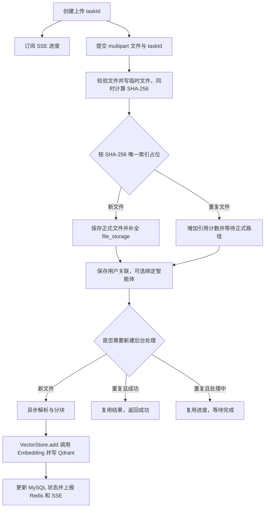

# SpringRAG 项目快速回顾

> 整理日期：2026-11-01。以当前工作区源码、`pom.xml` 和 SQL 为依据，包含尚未提交的改动。
>
> 这份文档用于恢复项目记忆。下文的“已有实现”表示源码中存在对应逻辑，运行情况和已发现的问题另行标明。

## 1. 先用 3 分钟找回整体印象

**这是一个用于学习的、计划采用 Spring Boot + Vue 3 的 RAG 问答项目；当前仓库主要是后端，开发重点停留在文件上传、异步向量化和进度通知。**

你原本想做的使用流程是：注册登录 → 配置模型提供商 → 创建智能体 → 上传知识库文件 → 创建会话 → 基于历史消息和知识库进行流式问答。

当前最需要记住的几件事：

- **账号链路已有实现**：密码哈希、JWT 登录、Redis 登出黑名单。
- **智能体已有部分管理接口**：创建、更新、删除，以及上传文件后绑定知识库；列表和详情接口尚未提供。
- **文件链路是代码主体**：校验文件 → 计算 SHA-256 → 去重落盘 → 保存关联 → 异步解析、分块 → 调用 Embedding 并写入 Qdrant → 通过 SSE 推送进度。
- **文件链路仍有阻断点**：例如用户文件记录没有填写 SQL 要求的 `name`；`.md` 虽有解析器，却没有分块策略。不能据此认为上传已经可以完整运行。
- **聊天和 RAG 查询尚未接通**：没有发送消息的 Controller，没有实际的聊天模型调用、相似度检索、上下文组装或回复流式输出。
- **当前仓库没有 Vue 工程**：Vue 3 是原始规划，仓库中未见前端源码、`package.json` 或前端启动脚本。

Git 最近一次提交是 `9f16a62`（2026-07-24，`temporarily on hiatus`）。此前两次提交分别涉及并发上传问题和文件进度重构。结合当前源码，可以把恢复工作的入口放在“文件链路收尾”，随后再接通聊天与检索。

**阅读路线：**只想恢复印象，读第 1、2、9 节；准备改代码，再读第 3～6 节；准备重新启动，先读第 7、8 节。

## 2. 系统由哪些部分组成

### 2.1 技术栈与各自职责

下面的版本来自当前 [pom.xml][pom] 和 Maven Wrapper 配置，不沿用旧需求文档中的版本。

| 部分 | 当前配置 | 在项目里的职责 |
| --- | --- | --- |
| Java | 25 | 编译和运行后端 |
| Spring Boot | 3.5.15 | Web 接口、依赖注入、配置、异步任务 |
| Spring AI | BOM 1.1.8 | 文档读取、文本分块、Embedding 与向量库集成 |
| MyBatis-Plus | 3.5.16 | Entity 与 MySQL 表映射、通用 CRUD |
| MySQL | JDBC 连接；SQL 使用 MySQL 8 系列排序规则 | 用户、智能体、会话、消息、文件元数据、模型提供商 |
| Redis | Spring Data Redis | JWT 黑名单、文件进度快照、上传任务映射 |
| Qdrant | Spring AI Qdrant Starter | 存储文档分块对应的向量和元数据 |
| Google GenAI Embedding | 配置模型名为 `gemini-embedding-2` | 把文本转换为向量；此处只代表配置值，未验证远端可用性 |
| JWT / 密码哈希 | java-jwt 4.5.2、Spring Security Crypto | 身份认证、密码校验；没有接入完整 Spring Security 登录流程 |
| Maven Wrapper | 3.9.16 | 固定项目使用的 Maven 分发版本 |

**MySQL、Redis、Qdrant 分别解决不同问题：**MySQL 记业务归属，Redis 记短期状态，Qdrant 保存供语义检索使用的文档向量。原始文件另存在本地磁盘。

Embedding 模型负责把文本变成向量，聊天模型负责生成回答。当前接入了前者的配置及调用路径，后者尚未实现。

### 2.2 功能完成到哪里

| 模块 | 源码现状 | 主要入口 |
| --- | --- | --- |
| 注册、登录、登出 | 已有业务逻辑及接口 | [UserController][user-controller]、[UserServiceImpl][user-service] |
| 请求鉴权 | `/api/**` 拦截，注册和登录除外 | [WebConfig][web-config]、[JwtInterceptor][jwt-interceptor] |
| 智能体管理 | 创建、更新、删除、绑定文件；接口存在待修问题 | [AgentController][agent-controller]、[AgentServiceImpl][agent-service] |
| 文件上传和去重 | 临时落盘、哈希、唯一索引占位、共享存储、用户关联 | [FileService][file-service] |
| 文件解析和入库 | `.txt` 有解析及分块路径；`.md` 只有解析路径 | [FileHandleService][file-handle]、[FileParser][file-parser]、[FileSplitter][file-splitter] |
| 文件进度 | Redis 最新快照、任务归属检查、SSE 订阅和补发 | [FileProgressService][file-progress]、[SseEmitterManager][sse-manager] |
| 会话、历史消息 | Entity、Mapper、通用 Service 骨架；没有对外业务接口 | `Session`、`ChatMessage` |
| 模型提供商 | Entity、Mapper、通用 Service 骨架；没有配置管理和模型调用逻辑 | [ModelProvider][model-provider] |
| 对话请求 | DTO 已定义，`ChatRequestService` 为空 | [ChatRequestService][chat-service] |
| RAG 检索 | 需求有分析，源码未见检索或 Prompt 拼接调用 | [项目需求分析.md][requirements] |
| 限流、热点缓存、API Key 加密 | 仍是需求，未见实现 | 原始需求 |

## 3. 代码地图：想改什么，就从哪里看

根包是 `com.aiplus.spring_rag`，位于 `H:/Desktop/SpringRAG/src/main/java/com/aiplus/spring_rag`。

| 目录或文件 | 用途 | 回顾时抓住什么 |
| --- | --- | --- |
| `controller/` | HTTP 请求入口 | 路径、请求参数、是否取 JWT 中的用户 ID |
| `dto/` | 请求、响应、进度事件的数据结构 | 与前端交换哪些字段；字段声明不代表业务已实现 |
| `entity/` | MySQL 数据映射 | `@TableName`、`@TableId`、JSON 字段的 `JacksonTypeHandler` |
| `mapper/` | 数据库访问 | 多数继承 `BaseMapper`；`AgentMapper` 有自定义 JSON 追加 SQL |
| `service/impl/` | 用户、智能体等业务实现 | `ServiceImpl` 提供基础 CRUD，类中新增的方法才是自定义业务 |
| `service/FileService.java` | 上传流程编排 | 去重、文件保存、关联记录、是否启动异步处理 |
| `service/FileHandleService.java` | 后台文件处理 | 策略表、解析、分块、向量写入、状态更新 |
| `service/FileProgressService.java` | 进度状态和任务关联 | `taskId` 与 `fileId` 的区别、快照和广播 |
| `manager/` | SSE 连接管理 | 连接存在 JVM 内存中，Redis 不存连接对象 |
| `config/` | 拦截器、线程池、时间填充、Markdown Reader | 自动配置之外，项目自己补充了什么 |
| `common/` | `Result<T>`、全局异常处理 | 返回结构目前并未完全统一 |
| `utils/` | JWT、密码、文件类型及哈希工具 | 文件允许列表在代码中另有一份 |
| [application.yaml][config] | 连接和存储配置 | 本机服务、局域网服务、API Key、相对存储路径 |
| [SQL/spring_rag.sql][sql] | 建表脚本 | 是删除旧表后重建的脚本，不是增量迁移 |
| [SpringRagApplicationTests.java][tests] | 现有测试 | 会启动完整 Spring 上下文，并真实写入 MySQL、Redis |

补充两个容易误判的地方：`FileService` 等文件类直接放在 `service/`，没有统一拆成接口与实现；`FileWriter.persistChunk()` 是空方法，实际向量写入发生在 `FileHandleService` 的 `vectorStore.add(chunks)`。

## 4. 数据怎么关联

### 4.1 MySQL 的 7 张业务表

| 表 | 保存什么 | 关键关联或约束 |
| --- | --- | --- |
| `user` | 登录账号、密码哈希 | `username` 唯一 |
| `agent` | 用户的智能体、系统提示词、模型参数、知识库文件 ID | `user_id`；同一用户下名称唯一；`file_ids` 为 JSON 数组 |
| `session` | 一次会话的名称、所属用户和智能体 | `user_id`、`agent_id` |
| `chat_message` | 消息正文、角色、Token 数、附件 | 联合主键是 `session_id + order` |
| `file_storage` | 共享文件的哈希、路径、大小、引用计数、向量化状态 | `sha256` 唯一 |
| `user_file_info` | 用户与共享文件的关联、用户侧文件名 | `user_id + file_id` 设计为唯一 |
| `model_provider` | 用户的提供商地址、密钥、模型列表 | `user_id`；实体另有 SQL 尚未包含的 `apiFormat` |

这些是业务关联。当前 SQL 没有声明表间外键约束，不能依靠数据库自动保证归属或级联删除。

**两个文件表是理解上传模块的关键：**`file_storage` 表示“磁盘上存了哪份内容”；`user_file_info` 表示“哪些用户拥有这份文件”。相同内容按 SHA-256 共享存储，不需要为每个用户再存一份实体文件。

同样要区分两种 ID：上传响应、向量元数据和 `agent.file_ids` 中的 `fileId`，实际指向 **`file_storage.id`**；`user_file_info.id` 是用户关联记录自身的 ID。

`ref_count` 当前会随重复上传增加，但同一用户的文件关联会去重。它还不能直接等同于“拥有该文件的用户数”，实现删除前需要明确引用计数的含义。

### 4.2 Qdrant 保存什么

当前 `.txt` 解析代码显式添加以下元数据：

| 字段 | 含义 |
| --- | --- |
| `file_id` | 对应 `file_storage.id` |
| `file_path` | 本地正式文件路径 |
| `user_id` | 触发这次解析的上传者 ID |
| `file_name` | 这次上传的原始文件名 |

文档文本和向量交给 Spring AI 的 `VectorStore` 处理。旧需求中还规划了分块序号、父文档等字段；本次没有读取实际 Qdrant 数据，不能将规划字段视为已验证的落库结果。

**后续检索的归属判断需要特别留意：**同一内容可以由多个用户共享，但向量可能只由首次上传者生成。如果仅按向量上的 `user_id` 过滤，后上传的合法用户可能查不到共享文件。接通 RAG 时，应结合用户文件关联、智能体绑定和会话附件确定允许检索的 `file_id` 范围，再验证权限隔离。

### 4.3 Redis 的实际 Key

| Key | 类型与内容 | 有效期 |
| --- | --- | --- |
| `blacklist:{token}` | String，登出后标为无效 | 登出时设置 7 天 |
| `upload:tasks:{taskId}` | JSON：`userId`、`fileId`、`status`、`stage` | 创建或更新时设置 2 小时 |
| `file:progress:{fileId}` | JSON：最新进度事件 | 每次上报设置 2 小时 |
| `file:tasks:{fileId}` | Set：订阅这个共享文件的任务 ID | 非终态上报时续期 2 小时，终态删除 |

注意实际前缀是 **`upload:tasks:`**，旧需求文档中的 `upload:task:` 与代码不同。

## 5. 三条核心流程

### 5.1 注册、登录、鉴权、登出

1. 注册：检查用户名 → 对密码先做 SHA-256 十六进制转换，再做 BCrypt 哈希 → 保存 `user`。
2. 登录：查询用户 → 按同样方式验证密码 → 签发含 `userId` 的 JWT，有效期 7 天。
3. 受保护请求：`JwtInterceptor` 读取 `Authorization` → 检查 Redis 黑名单 → 验证 JWT → 把 `userId` 放入请求属性。
4. Controller 从请求属性取当前用户 ID，传给业务层做数据归属过滤。
5. 登出：把当前 token 加入 Redis 黑名单，后续请求会被拒绝。

**调用约定：`Authorization` 头当前直接放 token 原文。**代码没有剥离 `Bearer ` 前缀，联调时加上该前缀会影响校验。用户身份来自服务端解析出的 JWT；上传 DTO 中的 `userId` 会被 Controller 覆盖。

### 5.2 文件从上传到向量入库



这是当前代码的主要分支；失败重试等未闭合情况见第 8 节。

上传编排在 [FileService][file-service] 中：

1. 检查非空、扩展名，在临时目录创建唯一文件。
2. 以 8 KiB 缓冲区流式写临时文件，同时计算 SHA-256，再做文本或魔数检查。
3. 尝试插入只含哈希、引用计数和初始状态的 `file_storage` 占位记录。**数据库唯一索引负责裁决并发请求谁来保存新文件。**
4. 新文件按哈希前两位、再两位分目录保存，例如 `storage/files/AB/CD/<SHA256>.txt`，然后补全数据库路径等字段。
5. 重复文件增加引用计数，最多等待约 10 秒获取正式路径，之后清理本次临时文件。
6. 保存用户关联；如果传了 `agentId`，尝试原子追加文件 ID 到智能体的 JSON 数组。
7. 新文件调用异步 `handle()`；重复且已完成的文件直接复用；重复且处理中的文件订阅现有进度。

`AgentMapper.appendFileId()` 用一条 SQL 完成归属过滤、JSON 追加和去重，避免并发上传时“先读取数组，再整体覆盖”造成丢失更新。没有更新到记录时，目前只记日志，上传流程仍可能继续。

### 5.3 后台处理与进度通知

处理线程池在 [AsyncConfig][async-config] 中配置：核心线程 2、最大线程 5、队列 50，线程名前缀 `file-handle-`。`FileHandleService.handle()` 通过 `@Async("fileHandleExecutor")` 运行。

| 阶段 | SSE `status / stage` | 进度值 | 发生什么 |
| --- | --- | --- | --- |
| 创建任务 | `PENDING / CREATED` | 0 | 尚未关联文件 |
| 文件已保存 | `PROCESSING / STORED` | 15 | 正式文件落盘 |
| 解析 | `PROCESSING / PARSING` | 40 | Reader 读取文档 |
| 分块 | `PROCESSING / SPLITTING` | 50 | 按扩展名选择分块策略 |
| 向量化 | `PROCESSING / EMBEDDING` | 60 | 调用 `vectorStore.add(chunks)` |
| 成功 | `SUCCESS / COMPLETED` | 100 | 更新 MySQL 状态并结束 SSE |
| 失败 | `FAILED / COMPLETED` | 100 | 记录失败并结束 SSE |

这些百分比是阶段标记，没有按字节数、块数或模型处理量计算。失败也会报 100，前端必须根据 `status` 判断结果。

`.txt` 使用 `TextReader`，分块设置为目标 1000 token、最小字符数 400、最小可嵌入长度 5，并指定中英文标点。`.md` 使用 `MarkdownDocumentReader`，配置包含引用块和代码块，但当前分块策略表没有 `.md`。

三种状态表示不要混用：

- MySQL `vectorized_status`：`0` 待处理、`1` 处理中、`2` 成功、`3` 失败。
- 上传响应 `status`：小写，如 `processing`、`success`。
- SSE 事件 `status`：大写，如 `PROCESSING`、`SUCCESS`、`FAILED`。

**为什么同时需要 `taskId` 和 `fileId`？**`taskId` 对应一次用户上传及其订阅权限，`fileId` 对应共享文件。多个上传任务可以订阅同一份文件的处理结果。

上报时先保存 Redis 最新快照，再向该文件关联的任务广播。订阅或重新连接时，会先发送 `connected` 事件，再补发最新的 `progress` 事件；它只补发最新状态，没有保存完整事件历史。

SSE 连接仅存于当前 JVM 内存，每个任务只保留一个连接，新连接会关闭旧连接；超时 30 分钟。当前没有跨实例消息转发机制。

## 6. 对外接口速查

默认地址为 `http://localhost:8080`。除注册、登录外，下表接口都需要 `Authorization` 头。

| 方法与路径 | 输入 | 返回或注意事项 |
| --- | --- | --- |
| `POST /api/user/register` | JSON：`username`、`password` | `Result<String>` |
| `POST /api/user/login` | JSON：`username`、`password` | token 放在 `data` 字段 |
| `POST /api/user/logout` | 当前 token | 将 token 加入黑名单 |
| `POST /api/agent/create` | `AgentDTO`，当前按表单或查询参数绑定 | `Result<String>`，不会返回新建智能体 ID |
| `POST /api/agent/update/{id}` | 路径 ID、`AgentDTO` | 当前路径变量名与参数名不一致，见第 8 节 |
| `POST /api/agent/delete/{id}` | 路径 ID | 同样有路径变量绑定问题 |
| `POST /api/file-progress/tasks` | 无业务请求体 | 直接返回 `{"taskId":"..."}` |
| `GET /api/file-progress/tasks/{taskId}/events` | 路径中的任务 ID | `text/event-stream`；会校验任务归属 |
| `POST /api/uploadFile` | `multipart/form-data` | 直接返回 `FileUploadResponseDTO` |

上传字段中，流程实际需要 `file` 和 `taskId`，`agentId` 可选。`sessionId`、`order`、`fileRealType` 虽已声明，但尚未接入对应的会话附件或额外校验逻辑；DTO 注释中的互斥约束也没有落实。

文件上传响应包含 `fileId`、`fileName`、`size`、`type`、`status`、`filePath`。**`size` 实际来自 `MultipartFile.getSize()`，单位是字节；DTO 注释写成了 KB。**`filePath` 是服务器存储路径，当前没有对应的鉴权下载接口。

联调顺序是：登录取 token → 创建任务取 `taskId` → 用同一用户订阅 SSE → 上传文件时带上这个 `taskId` → 根据终态判断是否成功。后端尚未在上传入口完整强制校验这一任务约定。

例如，在一个终端观察进度，另一个终端发上传请求；以下尖括号内容需要替换：

```powershell
curl.exe -N -H "Authorization: <token原文>" "http://localhost:8080/api/file-progress/tasks/<taskId>/events"
```

```powershell
curl.exe -H "Authorization: <token原文>" -F "taskId=<taskId>" -F "file=@H:/Desktop/SpringRAG/sample.txt" "http://localhost:8080/api/uploadFile"
```

浏览器联调还需处理 SSE 的鉴权头传递，以及跨域方案；当前项目只读取请求头中的 token，未配置 CORS。

普通用户和智能体接口采用 `Result<T>`，进度任务接口和上传接口返回裸对象。全局异常处理会返回 `code=500` 的业务 JSON，但没有显式设置 HTTP 错误状态，调用端不能只检查 HTTP 状态码。

## 7. 如何重新把环境拉起来

### 7.1 先核对配置和数据库

配置入口是 [application.yaml][config]，默认值包括：

| 配置项 | 当前值或位置 | 恢复环境时检查什么 |
| --- | --- | --- |
| 应用端口 | `8080` | 端口是否空闲 |
| MySQL | `localhost:3306/spring_rag`，用户 `root` | 库是否存在、表是否与源码一致、账号是否可用 |
| Redis | `192.168.124.3:6379` | 这是旧局域网地址，需按当前环境确认 |
| Qdrant | `192.168.124.3:6333`，集合 `spring-rag` | 确认服务和 gRPC 端口映射、API Key、TLS |
| Qdrant 初始化 | `initialize-schema: true` | 启动时可能创建集合，核对已有集合的向量维度 |
| Embedding | Google GenAI，模型名 `gemini-embedding-2` | 当前账号权限、模型是否可用、网络、密钥和输出维度 |
| 正式文件目录 | `./storage/files` | 相对应用启动目录解析 |
| 临时目录 | `./storage/temp` | 上传前需要存在，当前代码不会主动创建它 |

**Qdrant 端口需优先确认。**已检查本地 Spring AI 1.1.8 依赖：客户端使用 `QdrantGrpcClient`，该版本配置类的默认端口为 `6334`；本项目显式覆盖为 `6333`。如果服务端没有将 gRPC 映射到 6333，这项配置就需要调整。仅凭现有 YAML 无法确定旧服务器的映射情况。

配置中已有凭据，JWT 工具中也有硬编码签名密钥；本文不复制其具体值。恢复环境时应核对它们，模型提供商的 API Key 加密存储仍未实现。

**不要直接把 SQL 导入原有业务库。**[spring_rag.sql][sql] 包含 `DROP TABLE`，会重建业务表并删除旧 `file_info`。它没有创建或选择数据库的语句，也不是迁移脚本。先核对第 8 节的 SQL 和实体差异，再在独立测试库验证。

### 7.2 本地命令

在项目根目录运行。没有目录时可先创建文件存储目录：

```powershell
Set-Location H:/Desktop/SpringRAG
New-Item -ItemType Directory -Force -Path ./storage/files, ./storage/temp
```

构建与启动命令：

```powershell
.\mvnw.cmd -DskipTests compile
.\mvnw.cmd -DskipTests spring-boot:run
```

Wrapper 首次运行需要取得它指定的 Maven 分发包。本机若已有 Maven，也可以使用 `mvn -DskipTests compile` 和 `mvn -DskipTests spring-boot:run`。

先验证账号链路，再验证单个 `.txt` 的上传、向量入库和 SSE，最后验证重复及并发上传。由于第 8 节列出的问题尚未修改，这些命令和步骤是恢复入口，并不代表当前端到端流程已经通过。

## 8. 继续开发前，要先知道的具体问题

以下是对照源码发现的问题及其可能影响，**本次只整理文档，没有修改业务代码或数据库**。运行影响以实际数据库结构和服务配置为准。

### 8.1 优先排查：启动和首次上传

| 问题 | 依据与影响 |
| --- | --- |
| 用户文件名没有保存 | SQL 中 `user_file_info.name` 为 `NOT NULL`；[saveUserFileRef()][user-file-service] 只设置 `userId` 和 `fileId`。按该表结构首次插入关联时会失败，而且位置在启动异步处理之前。 |
| SQL 的唯一索引写法需校正 | `user_file_info` 使用 `Unique Key 'uk_user_file'`，索引名用了单引号。导入前应按标识符规则校正并在测试库验证。 |
| `.md` 不能走完处理链 | 解析策略有 `.md`，分块策略只有 `.txt`，Markdown 会在分块阶段报“不支持文件分块的类型”。 |
| 允许上传与支持处理不一致 | `FileUtils` 允许 `.txt/.md/.csv/.json/.java/.py/.c/.cpp/.pdf/.png/.jpg`；处理器只注册 `.txt/.md` 解析。其余类型即使通过校验，仍无法完成后续处理。 |
| YAML 文件配置没有全部接入 | `file.storage.allowed-file-types`、`max-file-size` 没有被上传代码读取；`docx` 虽写在 YAML 中，却不在工具类允许列表。也未设置 `spring.servlet.multipart` 大小限制，不能把 YAML 中的 50 MB 当成已经生效。 |
| Qdrant 配置需要核实 | 项目端口是 6333，依赖使用 gRPC 且默认端口为 6334；实际是否有自定义映射尚未验证。 |

### 8.2 文件并发、失败与权限边界

- **上传入口未校验任务归属和复用。**订阅 SSE 会调用 `judgeOwnedTask()`，但 `uploadFileHandle()` 没有同样的检查，也没有限制一个任务只能绑定一份文件。应先明确并落实 `taskId` 的有效性、所属用户和生命周期。
- **失败后的重复上传不会重新启动处理。**当前只有 `newFile` 分支调用 `handle()`；旧文件失败后再次上传，可能返回 `processing`，却没有新的后台任务。旧文件进度快照过期且未成功时，还可能报“本该被处理的文件未被处理”。
- **终态和快照更新仍有并发窗口。**重复上传会直接写任务的 `PROCESSING/STORED` 状态，与后台完成上报可能交错；连接注册后补发快照也可能与实时广播交错。需要针对状态倒退、漏终态和连接关闭做验证。
- **跨存储步骤没有完整补偿。**本地文件、MySQL、Redis、Qdrant 分步写入；后续失败时，已有文件、引用计数、关联记录和进度不一定同步回滚，部分异常路径也没有统一清理临时文件。
- **删除链路尚未完成。**未见用户文件删除、引用计数递减、磁盘文件和向量清理的完整实现；`FileHandleService` 中有关清理的代码仍是注释。

### 8.3 智能体、模型和接口的未完成部分

- `AgentController` 路径写 `{id}`，参数却是未显式指定名称的 `@PathVariable Integer agentId`，更新和删除接口需要对齐。
- `AgentDTO.name` 有 `@NotBlank`，Controller 未使用 `@Valid`；创建、更新接口也没有 `@RequestBody`。不能按“已支持 JSON 请求且自动校验”来联调。
- `ModelProvider` 已有 `apiFormat` 字段，但 SQL 缺少 `api_format`。`Agent.modelId` 是整数，聊天 DTO 的 `modelId` 是型号字符串，而提供商表保存模型名列表；真正的模型选择关系还需要统一。
- `chat_message` 使用联合主键，实体未声明对应主键映射。后续实现消息 CRUD 时，需要确认查询、更新和删除如何定位 `session_id + order`，不能直接假定通用 `ById` 方法适用。
- 缓存、限流、模型密钥加密、详细异常分类和角色权限没有实现。当前已经做的是 JWT 身份认证，以及部分查询或更新中的用户归属过滤。

## 9. 建议按这个顺序恢复开发

项目原有约定强调学习和小步迭代，适合一次打通一条短链路。

1. **先恢复环境和数据一致性。**核对服务地址、Qdrant 协议端口、Embedding 配置、SQL 与 Entity；在测试库解决用户文件名等首次上传阻断点。
2. **跑通单个 `.txt`。**观察磁盘文件、两张文件表、Redis 任务和快照、Qdrant 文档、SSE 终态，确认它们能对应起来。
3. **收尾上传模块。**统一允许类型和处理策略，补任务归属检查、失败重试、重复及并发上传行为；明确引用计数和删除规则。
4. **实现最小聊天闭环。**先完成模型提供商选择、一次消息调用、会话和消息持久化，再接回复的流式输出。
5. **接通 RAG。**根据问题检索用户有权访问的文件片段 → 与系统提示词、历史消息组装上下文 → 交给聊天模型生成回答。旧需求中关于历史上下文压缩和检索策略的讨论可作为后续设计输入。
6. **接入前端并扩展。**补智能体和会话的查询接口，接入 Vue 页面，再逐步完善缓存、限流和其他文件类型。

如果现在要打开代码，推荐顺序是：[FileUploadController][upload-controller] → [FileService][file-service] → [FileHandleService][file-handle] → [FileProgressService][file-progress] → [FileProgressController][progress-controller]。这条路线最接近暂停前正在做的工作。

## 10. 本次核对结果与资料优先级

本次查看了当前 Java 源码、配置、SQL、测试、需求文档、项目规则和最近提交记录，并检查了本地 Qdrant 依赖的客户端类型与默认端口。

在本机 **JDK 25.0.3、Maven 3.9.9** 下执行 `mvn -o -DskipTests compile`，命令成功；Maven 输出为 `Nothing to compile - all classes are up to date`。这是一轮利用已有构建产物的增量检查，不是全量冷构建，也不能证明外部服务连接或业务流程成功。

本次没有启动应用、调用模型、导入 SQL 或执行现有测试。测试中的 `testRedisConnection()` 会写 Redis 的 `test_boss`，`testInsertUser()` 会直接写用户记录，且没有回滚和清理逻辑，因此不适合作为无副作用的例行检查。

资料出现冲突时，按问题选择来源：

- **想知道当前代码做了什么**：看实际源码和配置。
- **想知道最初为什么这样设计**：看 [项目需求分析.md][requirements]，但其中的技术版本、Redis Key、部分元数据描述已与代码不同。
- **想知道原有学习约定和开发节奏**：看 [学习规则][study-rules] 与 [开发作战地图][roadmap]。地图中的阶段勾选已落后于源码，不宜继续当作当前完成状态。
- **想知道旧运行环境究竟如何**：还需在实际数据库、文件目录和服务端核验；仓库本身不能证明它们当前的内容与状态。

[pom]: H:/Desktop/SpringRAG/pom.xml
[requirements]: H:/Desktop/SpringRAG/项目需求分析.md
[config]: H:/Desktop/SpringRAG/src/main/resources/application.yaml
[sql]: H:/Desktop/SpringRAG/SQL/spring_rag.sql
[tests]: H:/Desktop/SpringRAG/src/test/java/com/aiplus/spring_rag/SpringRagApplicationTests.java
[user-controller]: H:/Desktop/SpringRAG/src/main/java/com/aiplus/spring_rag/controller/UserController.java
[user-service]: H:/Desktop/SpringRAG/src/main/java/com/aiplus/spring_rag/service/impl/UserServiceImpl.java
[web-config]: H:/Desktop/SpringRAG/src/main/java/com/aiplus/spring_rag/config/WebConfig.java
[jwt-interceptor]: H:/Desktop/SpringRAG/src/main/java/com/aiplus/spring_rag/interceptor/JwtInterceptor.java
[agent-controller]: H:/Desktop/SpringRAG/src/main/java/com/aiplus/spring_rag/controller/AgentController.java
[agent-service]: H:/Desktop/SpringRAG/src/main/java/com/aiplus/spring_rag/service/impl/AgentServiceImpl.java
[file-service]: H:/Desktop/SpringRAG/src/main/java/com/aiplus/spring_rag/service/FileService.java
[file-handle]: H:/Desktop/SpringRAG/src/main/java/com/aiplus/spring_rag/service/FileHandleService.java
[file-parser]: H:/Desktop/SpringRAG/src/main/java/com/aiplus/spring_rag/service/FileParser.java
[file-splitter]: H:/Desktop/SpringRAG/src/main/java/com/aiplus/spring_rag/service/FileSplitter.java
[file-progress]: H:/Desktop/SpringRAG/src/main/java/com/aiplus/spring_rag/service/FileProgressService.java
[sse-manager]: H:/Desktop/SpringRAG/src/main/java/com/aiplus/spring_rag/manager/SseEmitterManager.java
[model-provider]: H:/Desktop/SpringRAG/src/main/java/com/aiplus/spring_rag/entity/ModelProvider.java
[chat-service]: H:/Desktop/SpringRAG/src/main/java/com/aiplus/spring_rag/service/ChatRequestService.java
[user-file-service]: H:/Desktop/SpringRAG/src/main/java/com/aiplus/spring_rag/service/impl/UserFileInfoServiceImpl.java
[async-config]: H:/Desktop/SpringRAG/src/main/java/com/aiplus/spring_rag/config/AsyncConfig.java
[upload-controller]: H:/Desktop/SpringRAG/src/main/java/com/aiplus/spring_rag/controller/FileUploadController.java
[progress-controller]: H:/Desktop/SpringRAG/src/main/java/com/aiplus/spring_rag/controller/FileProgressController.java
[study-rules]: H:/Desktop/SpringRAG/.agents/rules/study-with-exercise.md
[roadmap]: H:/Desktop/SpringRAG/.agents/rules/project-framework-and-analysis.md
